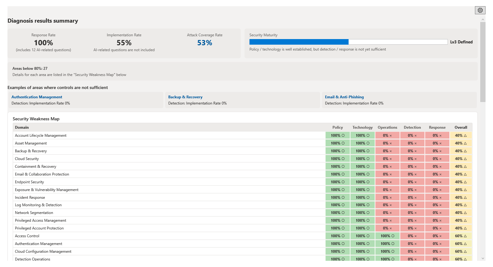
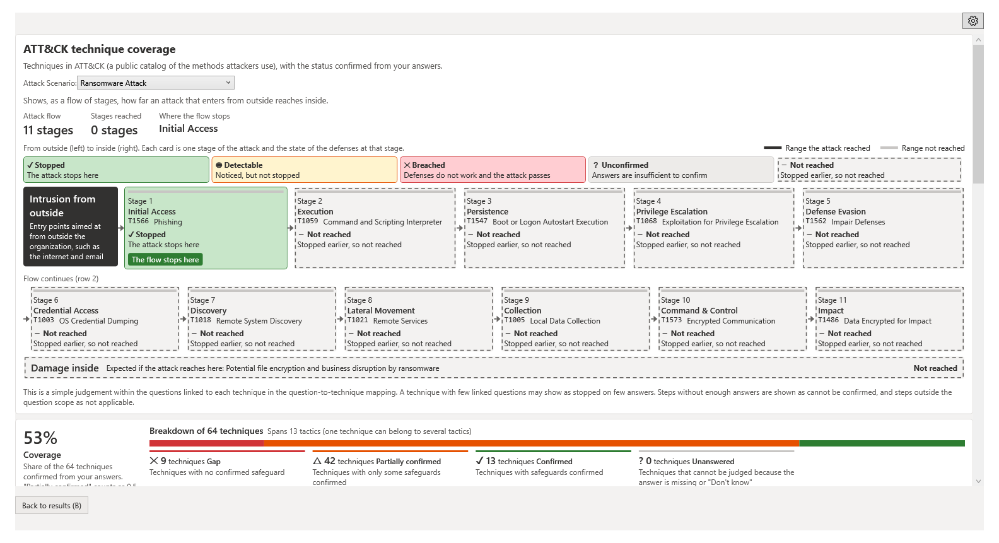
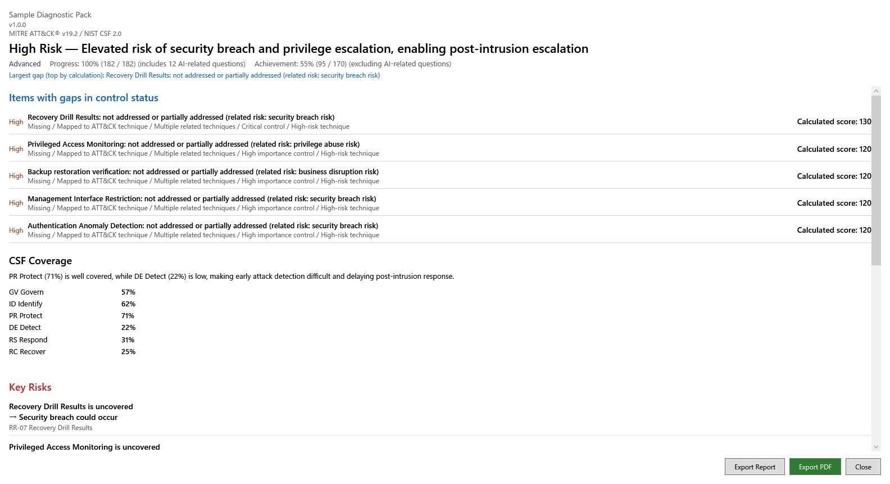

# SecureNavigator

An offline security assessment tool that organizes security posture by attack scenarios and guideline reference checks, then converts findings into actionable reports.

[日本語版](README.md)

---

## What SecureNavigator Does

SecureNavigator analyzes an organization's security posture from the attacker's perspective using MITRE ATT&CK-based attack scenarios. It reviews defenses against up to six representative attack patterns, identifies defensive gaps, and maps findings to IPA SME Guidelines (Japan), METI Cybersecurity Guidelines (Japan), and NIST CSF 2.0 as reference material. The tool organizes the layers and themes with low implementation and generates exportable reports for communication with management and stakeholders. All processing runs locally — no assessment data ever leaves the user's device.

## Who It's For

- **IT administrators** — Assess and document security posture for internal review
- **Security officers** — Identify defensive gaps and review the layers and themes with low implementation
- **SME managers** — Understand organizational security status without specialized expertise
- **Anyone who needs to communicate security improvements** — Generate structured reports for management briefings and improvement planning

## Key Features

- **Assessment data is never sent out** — All assessment data stays on the local device. No telemetry, no cloud dependency. The product communicates only for purchasing or restoring Pro in the Microsoft Store and for the license check at startup.
- **Attack Scenario Analysis** — Up to six attack scenarios based on MITRE ATT&CK techniques analyze how attacks progress through an organization's defenses step by step.
- **Guideline Reference Checks** — IPA SME Guidelines available in Free. METI Cybersecurity Guidelines and NIST CSF 2.0 available in Pro.
- **Layers and Themes with Gaps** — Themes with gaps and the reasons for each layer with low implementation (policy, technology, detection, response, operations). No time frames or rankings are shown.
- **Report Export** — Export assessment results as PDF, HTML, or Markdown reports. [Pro]
- **Advanced Analysis** — Detailed maturity breakdown, cause-and-action tables, Attack View contents (attack flow, tactic chips, status groups), and ATT&CK technique-level analysis. [Pro]
- **AI-related Reference Checks** — Display results referencing NIST AI RMF, Japan MIC AI Security Guidelines, Japan AI Guidelines for Business, IPA generative AI security materials, and UK NCSC Secure AI System Development guidance, inside the report. [Pro] (Reference checks only — not an indication of compliance, conformity, or certification.)
- **Japanese / English** — Full bilingual support for both assessment interface and generated reports.

## v1.3 Updates

- The initial questions now fit on one screen, showing the scope of the assessment (themes, questions, estimated time). "Not sure / undecided" is available.
- Reworked the question screen: switch between Single-question mode and List mode, filter by theme chips, see each theme's progress on Home, and each answer is saved automatically.
- Updated how the attack view is presented (left-to-right path diagram, tactic chips, groups by situation).
- Added explanations for technical terms.
- Corrected English wording in reports.
- File saving now uses a safe write method that keeps the original file intact if saving fails.
- Existing assessments remain available.

## Free vs. Pro

| Feature | Free | Pro |
|---------|:----:|:---:|
| Full assessment (all questions) | ✓ | ✓ |
| Attack scenario simulation | ✓ | ✓ |
| Layers and Themes with Gaps (on-screen) | ✓ | ✓ |
| IPA SME Guidelines reference checks | ✓ | ✓ |
| METI Cybersecurity Guidelines reference checks | — | ✓ |
| NIST CSF 2.0 reference checks | — | ✓ |
| AI-related reference checks (results referencing NIST AI RMF / Japan MIC AI Security Guidelines / Japan AI Guidelines for Business / IPA generative AI security materials / UK NCSC Secure AI System Development guidance. Not an indication of compliance, conformity, or certification. The results appear inside the report, so they are not shown in Free, which cannot open the report) | — | ✓ (badge, coverage bar & details in the report) |
| Advanced analysis (maturity detail, cause & action) | — | ✓ |
| Attack View contents (attack flow, tactic chips, status groups, ATT&CK technique detail analysis) | — | ✓ |
| PDF report export | — | ✓ |
| HTML / Markdown report export | — | ✓ |
| Japanese / English | ✓ | ✓ |
| Saved sessions | 1 | 3 |

## Use Cases

- **Periodic security review** — Organize the current state of defenses and clarify the layers and themes with gaps.
- **Management reporting** — Generate PDF reports that summarize security posture, defensive gaps, and items with gaps in control status for executive briefings.
- **Reviewing gaps** — Use the per-layer view to see where security measures have room for improvement.
- **Guideline reference checks** — Review status using IPA, METI, and NIST CSF 2.0 guidelines as reference material.

## Privacy & Offline Operation

SecureNavigator processes assessment data offline. It does not transmit assessment data, and does not include any telemetry or analytics. Assessment responses, evaluation results, and application settings are normally stored locally in a SQLite database (secnav.db) and a settings file under `%LocalAppData%\SecureNavigator\`. In the Microsoft Store version, Windows may store them in the corresponding location under `%LocalAppData%\Packages` instead. The default location for saved reports is `Documents\SecureNavigator\Reports`. Network activity occurs only for installation and updates via the Microsoft Store, purchase and restore of Pro, and license verification, which are handled by the OS / Store. Only when you select a button or link on screen, a public page of the product site, manual, support, or privacy policy opens in your default browser. When you select "Redeem" for a promo code, the Microsoft redemption page opens in your default browser.

## Screenshots

### Assessment Result Summary

### Attack Flow in the Attack View (Pro)

### Report Preview (Pro)

## Links

| | |
|---|---|
| Product Website | https://secure-navigator.sumikkolab.com/ |
| User Manual | https://secure-navigator.sumikkolab.com/manual/ |
| Privacy Policy | https://secure-navigator.sumikkolab.com/privacy-policy.html |
| Terms of Use | https://secure-navigator.sumikkolab.com/terms-of-use.html |
| Support | https://secure-navigator.sumikkolab.com/support.html |

## System Requirements

- Windows 10 Version 2004 or later / Windows 11
- WebView2 Runtime (required for PDF export)
- Internet: Not required for assessments (needed for installing or updating through the Microsoft Store, purchasing or restoring Pro, and the license check at startup)

## License

SecureNavigator is proprietary software. Free and Pro editions are available.

- **Free** — Personal or internal organizational self-assessment
- **Pro** — Internal evaluation, reporting, and improvement planning
- Commercial use for third parties requires a separate license appropriate for the intended use

See [Terms of Use](https://secure-navigator.sumikkolab.com/terms-of-use.html) for details.

---

© 2026 Sumikko Lab. All rights reserved.
