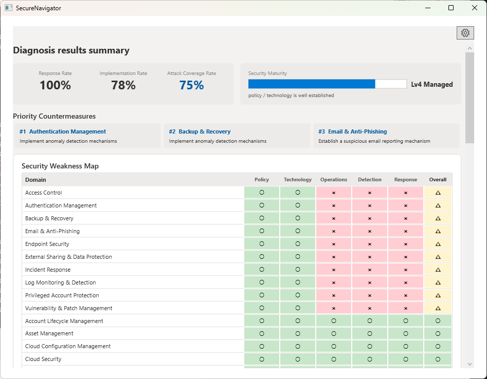
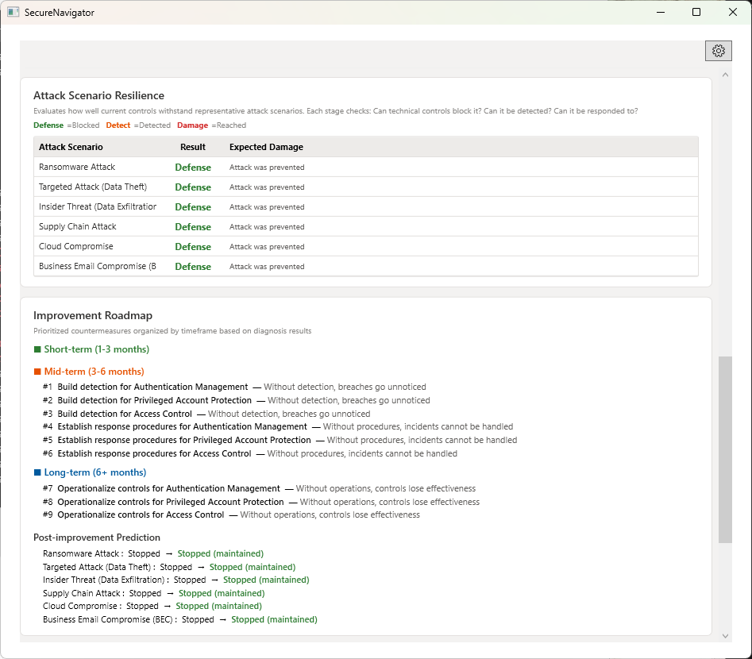
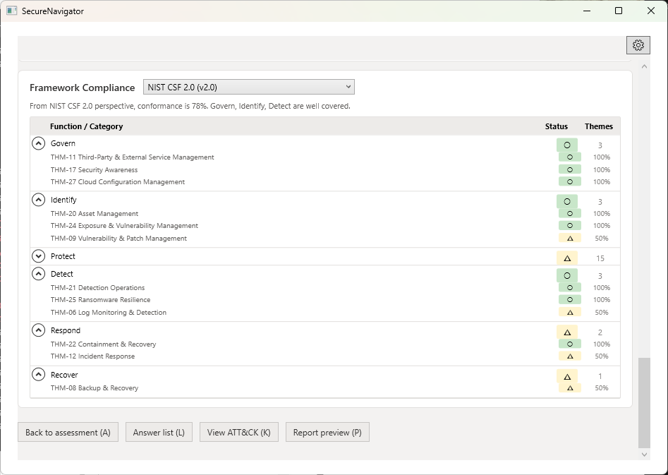
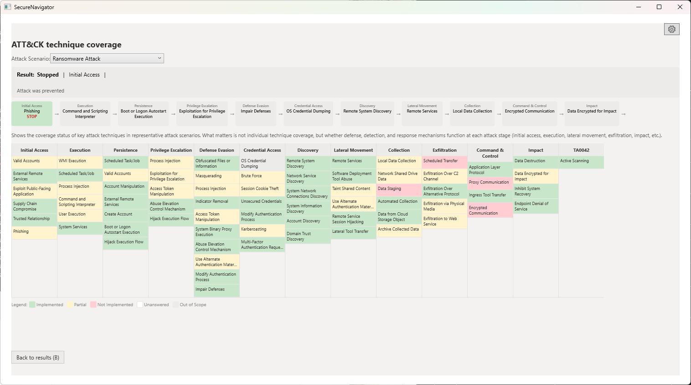
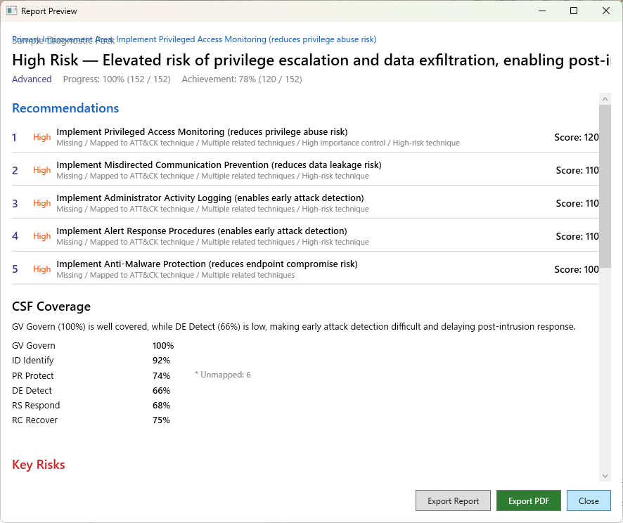

# SecureNavigator

An offline security assessment tool that organizes security posture by attack scenarios and guideline reference checks, then converts findings into actionable reports.

[日本語版](README.md)

---

## What SecureNavigator Does

SecureNavigator analyzes an organization's security posture from the attacker's perspective using MITRE ATT&CK-based attack scenarios. It reviews defenses against six representative attack patterns, identifies defensive gaps, and maps findings to IPA SME Guidelines (Japan), METI Cybersecurity Management Guidelines (Japan), and NIST CSF 2.0 as reference material. The tool generates exportable reports with suggested actions for communication with management and stakeholders. All processing runs entirely offline — no data ever leaves the user's device.

## Who It's For

- **IT administrators** — Assess and document security posture for internal review
- **Security officers** — Identify defensive gaps and prioritize improvements
- **SME managers** — Understand organizational security status without specialized expertise
- **Anyone who needs to communicate security improvements** — Generate structured reports for management briefings and improvement planning

## Key Features

- **Fully Offline** — All assessment data stays on the local device. No external communication, no telemetry, no cloud dependency.
- **Attack Scenario Analysis** — Six attack scenarios based on MITRE ATT&CK techniques analyze how attacks progress through an organization's defenses step by step.
- **Guideline Reference Checks** — IPA SME Guidelines available in Free. METI Cybersecurity Guidelines and NIST CSF 2.0 available in Pro.
- **Action Planning View** — Suggested actions and reasons for each layer with gaps (policy, technology, detection, response, operations). No time frames or rankings are shown.
- **Report Export** — Export assessment results as PDF, HTML, or Markdown reports. [Pro]
- **Advanced Analysis** — Detailed maturity breakdown, cause-and-action tables, and ATT&CK technique-level analysis. [Pro]
- **AI-related Reference Checks** — Display results referencing NIST AI RMF, Japan MIC AI Security Guidelines, Japan AI Guidelines for Business, IPA generative AI security materials, and UK NCSC Secure AI System Development guidance. [Pro] (Reference checks only — not an indication of compliance, conformity, or certification.)
- **Japanese / English** — Full bilingual support for both assessment interface and generated reports.

## v1.3 Updates

- The initial questions now fit on one screen, showing the scope of the assessment (themes, questions, estimated time). "Not sure / undecided" is available.
- Reworked the question screen: switch between Focus and Fast views, filter by theme chips, see each theme's progress on Home, and each answer is saved automatically.
- Updated how the attack view is presented (left-to-right path diagram, tactic chips, groups by situation).
- Added explanations for technical terms.
- Corrected English wording in reports.
- File saving now uses a safe write method that keeps the original file intact if saving fails.
- Existing assessments remain available.

## Free vs. Pro

| Feature | Free | Pro |
|---------|:----:|:---:|
| Full assessment (all questions) | ✓ | ✓ |
| Attack scenario simulation | ✓ | ✓ |
| Action Planning View (on-screen) | ✓ | ✓ |
| IPA SME Guidelines reference checks | ✓ | ✓ |
| METI Cybersecurity Guidelines reference checks | — | ✓ |
| NIST CSF 2.0 reference checks | — | ✓ |
| AI-related reference checks (results referencing NIST AI RMF / Japan MIC AI Security Guidelines / Japan AI Guidelines for Business / IPA generative AI security materials / UK NCSC Secure AI System Development guidance. Not an indication of compliance, conformity, or certification) | Badge & coverage bar | Badge, coverage bar & details |
| Advanced analysis (maturity detail, cause & action) | — | ✓ |
| ATT&CK technique detail analysis | — | ✓ |
| PDF report export | — | ✓ |
| HTML / Markdown report export | — | ✓ |
| Japanese / English | ✓ | ✓ |
| Saved sessions | 1 | 3 |

## Use Cases

- **Periodic security review** — Organize the current state of defenses and clarify suggested actions.
- **Management reporting** — Generate PDF reports that summarize security posture, defensive gaps, and recommended actions for executive briefings.
- **Action planning** — Use the per-layer view to see where security measures have room for improvement.
- **Guideline reference checks** — Review status using IPA, METI, and NIST CSF 2.0 guidelines as reference material.

## Privacy & Offline Operation

SecureNavigator operates 100% offline. It does not connect to any external server, does not transmit assessment data, and does not include any telemetry or analytics. Assessment responses, evaluation results, and application settings are stored locally in a SQLite database (secnav.db) and a settings file under `%LocalAppData%\SecureNavigator\`. The default location for saved reports is `Documents\SecureNavigator\Reports`. Network activity occurs only for installation and updates via the Microsoft Store, purchase and restore of Pro, and license verification, which are handled by the OS / Store. When you click a link in the app, a public page of the product site opens in your default browser.

## Screenshots

### Assessment Result Summary

### Attack Scenario Resilience / Action Planning

### Framework Reference Checks (NIST CSF 2.0)

### ATT&CK Technique Coverage (Pro)

### Report Preview (Pro)

## Links

| | |
|---|---|
| Product Website | https://secure-navigator.sumikkolab.com/ |
| User Manual | https://secure-navigator.sumikkolab.com/manual/ |
| Privacy Policy | https://secure-navigator.sumikkolab.com/privacy-policy.html |
| Terms of Use | https://secure-navigator.sumikkolab.com/terms-of-use.html |
| Support | https://secure-navigator.sumikkolab.com/support.html |

## System Requirements

- Windows 10 Version 2004 or later / Windows 11
- WebView2 Runtime (required for PDF export)
- Internet: Not required (fully offline operation)

## License

SecureNavigator is proprietary software. Free and Pro editions are available.

- **Free** — Personal or internal organizational self-assessment
- **Pro** — Internal evaluation, reporting, and improvement planning
- Commercial use for third parties requires a separate license appropriate for the intended use

See [Terms of Use](https://secure-navigator.sumikkolab.com/terms-of-use.html) for details.

---

© 2026 Sumikko Lab. All rights reserved.
